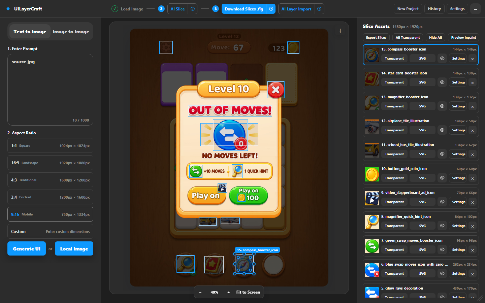
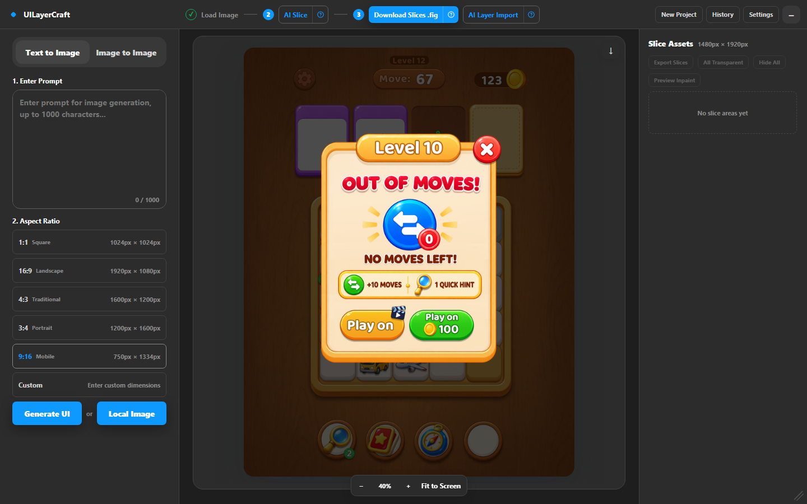
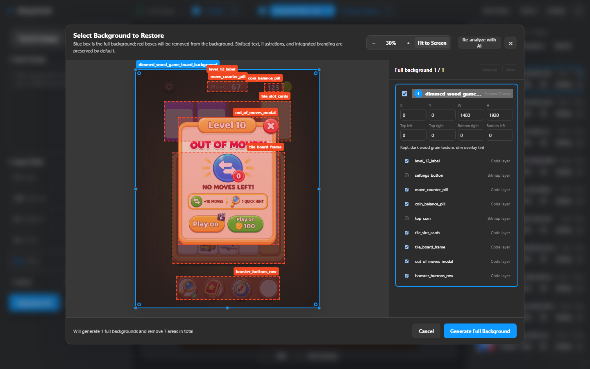
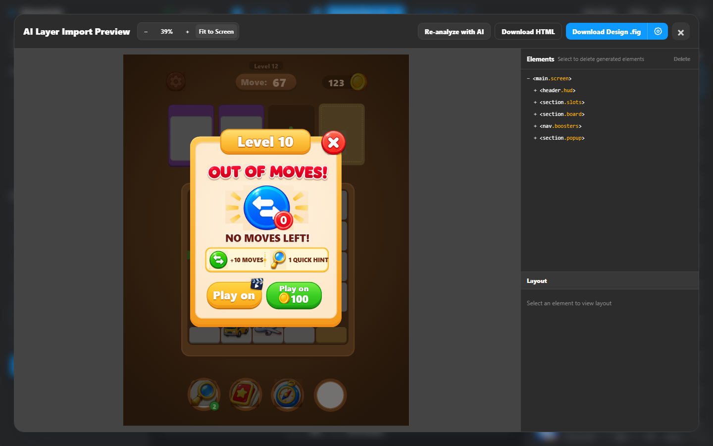
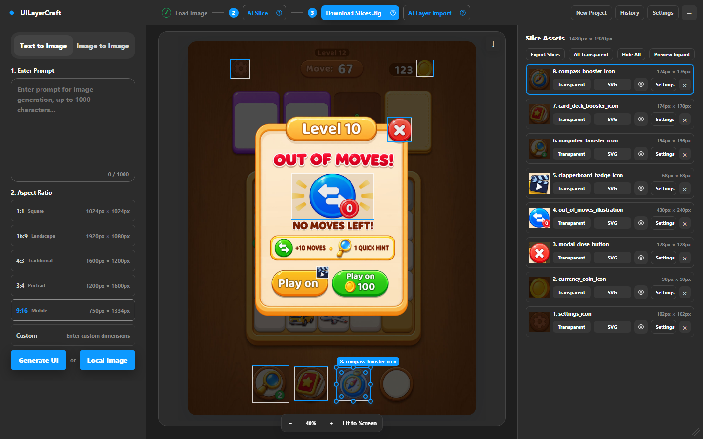

# UILayerCraft

UILayerCraft turns a flat UI image into something you can build with. It finds the parts that must stay as images (icons, illustrations, stylized lettering, product shots), cuts them out as named slice assets, and hands you a Figma file, editable Figma layers or an HTML/CSS package.

It runs as a **Figma Desktop plugin** or as a **standalone web page**, backed by a small local Node.js service.



## Why

Mockups from image models (GPT Image, Nano Banana, Midjourney…) look finished, but they are a single bitmap. Handing one straight to a coding model produces poor results, because the model has to guess which pixels are code (text, buttons, cards, layout) and which must ship as image assets.

UILayerCraft makes that split explicit:

- **Slice assets**: icons, illustrations, badges and lettering are detected, cropped at their original pixel coordinates and named in `snake_case` (`compass_booster_icon`, `out_of_moves_title_lettering`).
- **Code layers**: buttons, panels, counters and text are left for HTML/CSS or native Figma nodes.
- **Full backgrounds**: when a background is covered by UI, the covered areas can be removed and repainted by an image model, so the background ships as one clean asset.

## Features

| Area | What you get |
|---|---|
| Input | Local PNG/JPEG/WebP, or text-to-image / image-to-image generation (256–4096 px) |
| AI Slice | One-click detection of slice assets and full-background candidates, with a confirmation canvas for the areas to remove |
| Manual calibration | Draw, move, resize, round corners, hide, delete or replace slices; brush/eraser mask editor with AI inpaint |
| Transparency | Local edge removal or AI transparency per slice, SVG redraw/vectorize |
| Output | Slice package ZIP, `.fig` file (imports into Figma web or desktop), direct import into the open Figma file, editable layers via AI Layer Import, HTML/CSS ZIP |
| Models | Any OpenAI-compatible API, or a logged-in **Claude Code / Gemini CLI** for vision tasks with no API key |

## Quick start

Requirements: Node.js `>= 20.19.0` (`.nvmrc` pins `22.22.2`), npm, and either an OpenAI-compatible API key or a logged-in Claude Code / Gemini CLI.

```bash
git clone https://github.com/Hieutapcode3/UILayerCraft.git
cd UILayerCraft
npm install
npm run api            # local service on http://127.0.0.1:18787
```

On Windows double-click `menu.bat` and choose **1. Set up and start** to install and start everything (macOS: `deploy-environment.command`). Keep the service window open while you use the plugin.

### Use it in Figma Desktop

1. `npm run build`
2. In Figma Desktop: **Plugins → Development → Import plugin from manifest…** and pick `manifest.json`.
3. Run **UILayerCraft**. If it shows "Local service disconnected", start `npm run api` and click **Reconnect**.

### Use it in the browser

Open `dist/ui.html` while `npm run api` is running. Outputs that would go into Figma are downloaded as `.fig` files instead; drag one into Figma (web or desktop) to import it.

## Workflow

The top bar follows the three steps: **① Load Image → ② AI Slice → ③ Export**.

### 1. Load an image

Click **Local Image** or generate one with a prompt and aspect ratio.



### 2. AI Slice

**AI Slice** asks the vision model for slice assets and full-background candidates. Regular slices land on the canvas and in the **Slice Assets** panel. If a background candidate is found, a confirmation canvas opens: the blue box is the background to keep, red boxes are UI layers to remove from it.



- **Generate Full Background** sends the background and the removal mask to the image model and adds two versions to the asset list: *AI completion · original* and *AI completion · local composite*, which keeps every untouched pixel. Keep the one you prefer.
- **Cancel** keeps the regular slices and skips background generation. This is all you need when you only want the small elements.

Results are suggestions: adjust any slice on the canvas, or open **Settings** on a slice for exact coordinates, name and corner radius.

### 3. Export

| Button | Result |
|---|---|
| **Export Slices** | ZIP with every slice PNG and a `manifest.json` of names and coordinates |
| **Import Slices** / **Download Slices .fig** | A Figma frame with the reference image and every slice at its original position (no AI request) |
| **AI Layer Import** | The vision model rebuilds text, layout and slice references as HTML/CSS; preview it with the **Elements** inspector, then import editable layers, download a `.fig`, or **Download HTML** |
| **Export HTML** (collapsed window) | Exports the selected Figma frame as a fixed-size HTML ZIP, independent of AI |

For browser-only effects (pseudo-elements, filters, clip paths, complex gradients) enable **High-fidelity capture (Playwright/CDP)** in the import settings. Run `npx playwright install chromium` once first.

## Example

[`examples/out-of-moves/`](examples/out-of-moves/) holds a full run on a mobile game popup (1480 × 1920):

- `source.jpg`: the input image
- `slices/`: 15 slice PNGs and `manifest.json` from **Export Slices**
- `out-of-moves-slices.fig`: the same slices as a Figma file; drag it into Figma to open it
- `html/`: the AI Layer Import result as HTML/CSS (open `html/index.html`)
- `out-of-moves-editable.fig`: the AI Layer Import result as editable Figma layers (72 layers, 12 editable text layers such as "Level 10", "NO MOVES LEFT!" and "Play on")



Vision model comparison on this image:

| Model | Time | Slices | Notes |
|---|---|---|---|
| Claude Code CLI (`cli://claude`) | < 1 min | 15 | Found every icon, the title lettering, the ad badge and the tile illustrations |
| Gemini 3.8 Flash (API) | ~52 s | 8 | Main icons only; missed the small hint/move icons and the tile illustrations |



## Model configuration

Open **Settings → + New API**:

| Field | Value |
|---|---|
| Base URL | `https://…` for an OpenAI-compatible API, or `cli://claude` / `cli://gemini` for a local CLI |
| Model | Provider model ID; for CLIs `default`, `sonnet`, `opus`, `haiku` or a Gemini model name |
| Timeout | 30–1800 s (default 500 s) |
| API Key | Stored only in `.local-provider-config.json`; leave empty for CLIs |
| Purpose | **Vision Model** (AI Slice, AI Layer Import, SVG) or **Image Generation / Inpaint** (generation, transparency, background restoration, inpaint) |

Then pick the config for each purpose under **Active Routing**.

HTTP providers must implement `POST /v1/chat/completions` (vision), `POST /v1/images/generations` and `POST /v1/images/edits` (image tasks).

### Using a CLI instead of an API key

Install and log in to [Claude Code](https://docs.claude.com/en/docs/claude-code) (`claude`) or the Gemini CLI (`gemini`), then create a **Vision Model** config with Base URL `cli://claude` or `cli://gemini` and an empty API key. The service writes the image to a temporary folder and runs the CLI in read-only mode (Claude only gets the `Read` tool). CLI configs cannot be used for image generation or inpainting. Calls use your CLI subscription quota.

## Architecture

```text
Figma Desktop / browser
├─ UI (src/ui)                 canvas, slicing, previews, state, API client
├─ Plugin main (src/plugin)    Figma API: node creation, import, frame serialization
└─ Local API (src/server, entry src/server/index.js)
   ├─ model configs, OpenAI-compatible and CLI providers
   ├─ generation, editing, transparency, SVG, background restoration
   ├─ progress, workspace drafts, thumbnails
   ├─ Playwright DOM capture
   └─ .fig packaging (src/fig-export, openfig-core)
```

| Directory | Responsibility |
|---|---|
| `src/ui/` | Plugin UI (`app.js`, `api/`, `state/`, `services/`, `renderers/`, template and styles) |
| `src/plugin/` | Figma main-thread code |
| `src/server/` | HTTP routes, providers, model config, image services, storage |
| `src/core/` | Shared slice detection, background decomposition and image size rules |
| `src/fig-export/` | Figma API adapter and `.fig` encoding for web mode |
| `src/vendor/` | Locally bundled third-party scripts |
| `dist/` | Build output loaded by Figma; generated, do not edit |

## Development

```bash
npm run build      # dist/ui.html, dist/code.js, dist/figma-sim.js
npm test           # unit tests + syntax checks
npm run preview    # http://127.0.0.1:4173/figma-sim.html, a simulated Figma canvas
```

Agent rules are in [AGENTS.md](AGENTS.md), working rules in [standards/](standards/README.md) (branch flow: [standards/git-flow.md](standards/git-flow.md)), the product overview in [docs/project-context.md](docs/project-context.md), and the state of the work in [handoff/](handoff/README.md), one folder per session. CI runs build and tests on every push to `main` and `dev/Hieuthu3`.

## Local data and security

These files belong to the machine running the service and are git-ignored:

```text
.local-provider-config.json   model configs and API keys
.uilayercraft-history/        workspace drafts, images and previews
```

The service has no authentication. Run it on `127.0.0.1`; if you expose it, put HTTPS, authentication and an IP allowlist in front of it. Environment variables: `HOST`, `PORT` (default `18787`), `EDITABLE_HTML_MAX_TOKENS`, `SVG_MAX_TOKENS`, `DECOMPOSITION_MAX_TOKENS`.

## Known limitations

- AI results need review; text, grouping and CSS are not guaranteed to match the image exactly.
- HTML can render differently after conversion to Figma; complex filters, masks and blend modes may be approximated or rasterized.
- `.fig` is Figma's private format, produced through `openfig-core`; a Figma format change may need an update.
- One main image per workspace; the plugin UI always talks to `127.0.0.1:18787`.

## Troubleshooting

| Symptom | Fix |
|---|---|
| "Local service disconnected" | Start `npm run api`, check `curl http://127.0.0.1:18787/health`, click **Reconnect** |
| AI Slice says a model "is no longer available" | The provider retired that model; pick a current model in **Settings** |
| CLI config fails | Run `claude -p "hi"` or `gemini -p "hi"` in a terminal to check the CLI is installed and logged in, then restart `npm run api` |
| AI Layer Import shows an old result | Results are cached per workspace; click **Re-analyze with AI** |
| **Export HTML** is disabled | Select exactly one complete frame on the Figma canvas |

## Third-party components

- [openfig-core](https://github.com/OpenFig-org/openfig-core) for `.fig` encoding
- Figma's HTML-to-design `capture.js`, bundled in `src/vendor/`

## License

[MIT](LICENSE)
